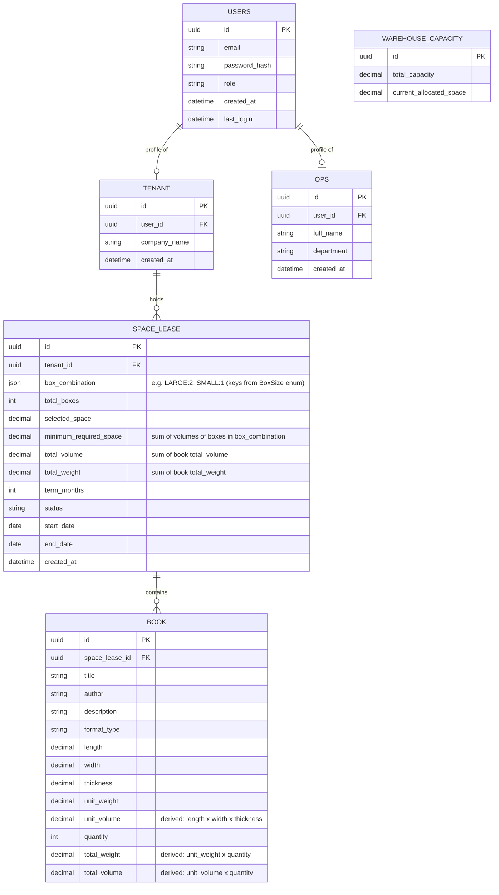

# Entity Relationship Diagram

## App ownership

| App | Tables |
|---|---|
| `users` | `USERS`, `TENANT`, `OPS` |
| `inventory` | `BOOK` |
| `lease` | `SPACE_LEASE` (also holds the `BoxSize` enum and the greedy packing function) |
| `capacity` | `WAREHOUSE_CAPACITY` |